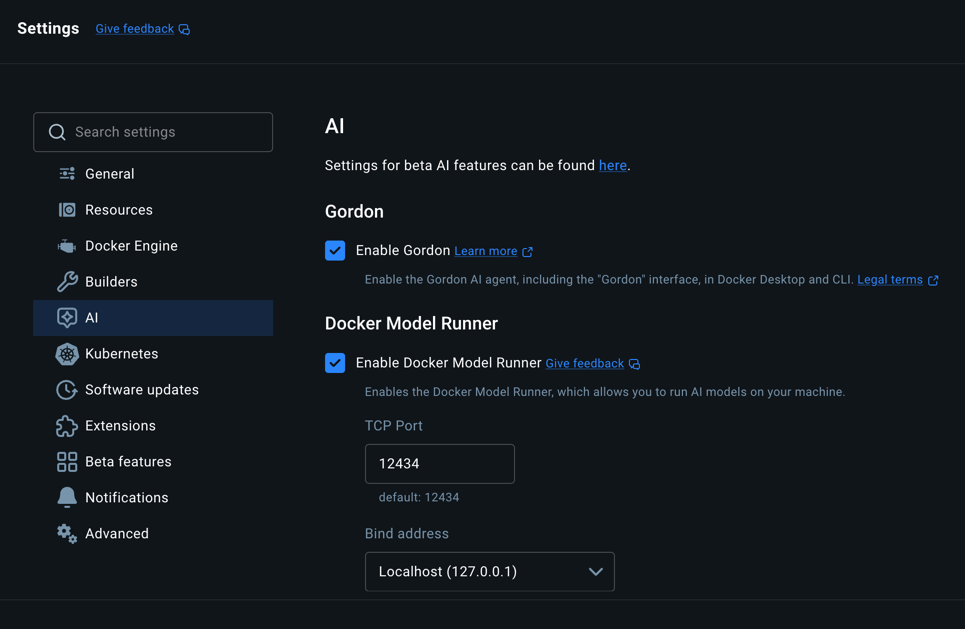

# When it does not work

Almost every message in this guide names the wrong thing. That is not carelessness —
it is what a layered system says when a component it depends on goes quiet. The
installer says the appliance is unreachable when the appliance is fine and busy waiting
on OpenAI. The console says the server is starting when the server has been up for an
hour. A pull fails with a credentials error before it ever contacts a registry.

So this guide is keyed on **the sentence you actually see**, and each entry says what
the message proves, what it does not, and the one command that separates them.

## Start here, always

```bash
embabel doctor
```

Every line in it is a real failure somebody hit, with the fix attached. It checks the
host: Docker, compose, credential helpers, the Model Runner, the embedding model, your
realm checkouts, and how much room Docker has. It does **not** check a running appliance —
for that, keep reading.

## Which appliance

A machine can run more than one appliance, so the commands below name containers
through `$P`, the appliance's compose project. Set it first:

```bash
P=embabel-appliance        # the default; another instance is embabel-<name>
```

Containers are then `$P-<service>-1`. Run compose as `embabel --instance <name>
compose …` rather than bare `docker compose`, which acts on the default appliance and
starts containers without their memory limits. `embabel instances` lists what is installed;
`embabel --instance <name> doctor`, `status` and `logs` pick one for you, and
`EMBABEL_INSTANCE=<name> sh doctor.sh` does the same for the script below.

## If there is no `embabel` command yet

The install never got far enough to leave one. Nothing here needs it:

```bash
curl -fsSL https://raw.githubusercontent.com/embabel-worlds/appliance/main/doctor.sh | sh
```

That checks the same machine from the outside — Docker, the credential helper, memory and
disk, every Embabel container and whether it is actually staying up, both doors, and the
recent errors — and ends with a numbered list of what to fix, in order. It reads only. It
starts nothing, deletes nothing, and prints no password, key or token, so the output is
safe to paste into an issue.

If you already have the checkout, `sh doctor.sh` inside it does the same thing.

## Working with a coding agent instead

If you have Claude Code or a similar agent, `skills/appliance-doctor` teaches it to do all
of this for you and explain the result in plain words. It assumes the appliance's own tools
are unavailable, because if they worked you would not be reading this — and it can be
fetched without a checkout, since the install that would have made one is what failed:

```bash
mkdir -p ~/.claude/skills/appliance-doctor && curl -fsSL \
  https://raw.githubusercontent.com/embabel-worlds/appliance/main/skills/appliance-doctor/SKILL.md \
  -o ~/.claude/skills/appliance-doctor/SKILL.md
```

Then ask your agent to work out why Embabel will not start.

## The two logs, and why this matters more than anything else here

`docker logs` shows you a **filtered** view. Under the appliance profile the console
appender passes operator-relevant lines and warnings, and routes known-harmless
framework noise to file only. The full log holds two to six times more, depending on how
busy the appliance has been — measured on one machine as 160 lines against 1041 shortly
after boot, and 1434 against 2866 after a working session.

The full log lives **inside the container**:

```bash
# the filtered operator view
docker logs --tail 80 $P-worlds-1

# everything
docker exec $P-worlds-1 tail -100 logs/assistant.log
```

**`/app/logs` is not on a volume.** It survives a restart; it does not survive the
container being recreated. If something is crash-looping and you want the log from a
previous boot, take a copy first — this works on a stopped container too:

```bash
docker cp $P-worlds-1:/app/logs/assistant.log ./assistant.log
```

---

## `error getting credentials — docker-credential-desktop: executable file not found`

**What it means.** Nothing was pulled, and no registry was contacted. Your
`~/.docker/config.json` names a credential helper — `"credsStore": "desktop"` is what
Docker Desktop writes — and the Docker CLI runs that binary for *every* registry,
including anonymous pulls of public images. The binary is not on your PATH.

The appliance's images are public and need no credentials at all, so this failure is
pure configuration.

**Fix, without admin rights:**

```bash
export PATH="$PATH:/Applications/Docker.app/Contents/Resources/bin"
```

Add that to your shell profile so it survives a new terminal. **Or** delete the
`"credsStore"` line from `~/.docker/config.json` — with the trade that you will need to
`docker login` again for private registries, and those credentials will then sit in that
file rather than in your keychain.

`embabel doctor` reports this one before you get as far as a pull.

---

## `The appliance did not answer within 180s, because it is still waiting for OpenAI`

**What it means.** Exactly what it says, and the appliance is not the problem. When you
give it a provider key, the server validates it by making a **real** call to the
provider with the provider's own client — not a model list, because a key that can list
models can still fail the first real request. If that call never comes back, this is
what it looks like from the installer.

A network that *drops* traffic rather than refusing it produces precisely this. A proxy,
a corporate firewall, a VPN.

**Prove it, from inside the container, because that is where the blocked egress is:**

```bash
docker exec $P-worlds-1 sh -c \
  'curl -s -o /dev/null -w "%{http_code} in %{time_total}s\n" --max-time 20 https://api.openai.com/v1/models'
```

A healthy machine answers **`401 in 0.18s`** — 401 is correct, it means reachable and
unauthenticated. A hang, or `000`, means blocked, and no key will get through until that
does.

**The way out** is to skip the provider step (press Enter), finish the install, and put
the key in `secrets.env` beside the compose files afterwards. The container reads it
directly and never goes through the wizard's validation.

---

## `Could not reach the appliance … (RemoteDisconnected)` at "Finishing…"

**Your install almost certainly succeeded.** Completing setup restarts the appliance so
the model beans are rebuilt with your provider key, and the server persists completion
*before* it schedules that restart. On older installers, losing the race between the
response and the restart ended the run with this message.

Current versions ride the restart out and verify. If you see it on an older one:

```bash
docker logs $P-worlds-1 2>&1 | grep "Setup complete — restarting"
embabel up
```

The first line is the server logging its own restart on the way out. `embabel up` will
say *"This appliance is already set up"* and give you the address — that is the closing
block you did not get. Your MCP token and coding-agent wiring are intact; they are
established before the finish.

---

## The console sits on "Connecting to Worlds" or "The Worlds server is still starting"

The console polls `/api/v1/realms` every two seconds and leaves that screen as soon as it
gets any real status back — **including a 401**, which is the normal answer before you
sign in. Staying there means the request is coming back as a connection failure or not at
all.

There is no proxy in the way to be the problem. The server serves the console itself, so
the console's origin and the API's are the same thing, and what your browser does is what
`curl` does:

```bash
# the console's own address, and the call it is waiting on
curl -s -o /dev/null -w "%{http_code} in %{time_total}s\n" --max-time 60 http://localhost:11044/api/v1/realms

# the same server on its other port, to tell a port-mapping problem from a server one
curl -s -o /dev/null -w "%{http_code}\n" --max-time 60 http://localhost:11043/api/v1/realms

# what the server itself says it did
docker logs --tail 30 $P-worlds-1
```

A working appliance answers **`401 in 0.004s`** on the first two. Then:

| What you see | Meaning |
|---|---|
| 401 on both | the server is answering correctly — the problem is in the browser; hard-refresh or use a private window |
| nothing on 11044, 401 on 11043 | the port mapping, not the server: `embabel compose ps` and compare with `.env` |
| nothing on either | the server is not up or not finished starting — `embabel status`, then the logs above |
| 404 on `http://localhost:11044/ui/` | the server is up and has no console to serve. Almost always an image older than the console itself: the files travel inside the server image, and `:latest` only carries them from the first release that followed. `embabel version` names the tag; take a newer one, or `EMBABEL_VERSION=edge` in `.env` to track main. Not a port or proxy problem — the 401s above already proved the port reaches the server |

---

## `Bearer token resolved to user 'x' but the user could not be loaded`

**What it means.** An MCP client is connecting with a token that names a user the
appliance cannot load. Two causes, deliberately indistinguishable to the caller so that
an unauthenticated client cannot probe which usernames exist: the user is not there, or
the user is there with no stored credential.

Repeated warnings are almost always a coding agent retrying on a schedule. It is a
symptom, not a cause.

The usual reason is a token left over from an earlier install attempt naming an account
that was later recreated under a different name. The data volume survives a plain
reinstall; only `embabel uninstall` or `--fresh` clears it.

```bash
docker exec $P-worlds-1 sh -c '
echo "token names:"; grep -o "EMBABEL_SETUP_MCP_TOKEN_USER=.*" /data/embabel/assistant/admin/providers.env
echo "credentials hold:"; sed -nE "/^credentials:/,/^[a-zA-Z]/p" /data/embabel/assistant/admin/.credentials.yml | sed -E "s/^( +)([A-Za-z0-9_.-]+): .*/\1\2/"'
```

The two names must match. If they do not, re-run `embabel up` to mint a token for the
account that actually exists, or `embabel agents` to re-point your coding agents.

---

## Neo4j connection failures in the log

On a Neo4j appliance. On the Embabel engine there is no Neo4j to connect to, and a line
like these means the server was started without its engine overlay — check that `.env`
says `GRAPH_TYPE=EMBABEL` and start it through `embabel up`, not a bare `docker compose`.

**These are never routine.** A healthy appliance logs nothing about Neo4j even when
Neo4j is restarted underneath it — the driver reconnects lazily and silently. Verified by
bouncing it under a live appliance: zero lines, and every surface kept answering.

So take them seriously, and start with *when*:

```bash
docker exec $P-worlds-1 sh -c 'grep -nE "7687|Neo4j|ServiceUnavailable" logs/assistant.log | tail -5'
docker inspect -f 'worlds started {{.State.StartedAt}}' $P-worlds-1
```

Lines older than that start are from a previous life of the process and are spent. Lines
newer than it are live.

**The hostname matters more than the port.** `neo4j:7687` is correct — that is the
container-to-container address. `localhost:7687` is not, and would mean the container was
not created from these compose files. (The port a *browser* on your machine would use is
`11046`, and the app never uses it.)

If the address is right, look at Neo4j itself:

```bash
docker inspect -f 'health={{.State.Health.Status}} restarts={{.RestartCount}} OOM={{.State.OOMKilled}}' $P-neo4j-1
docker logs --tail 60 $P-neo4j-1
docker info --format '{{.MemTotal}}'
```

**`OOMKilled` is usually `false` even when memory is the cause**, so do not read it as the
verdict. Neo4j checks its own configuration before it starts and refuses outright rather
than being killed:

```
ERROR Invalid memory configuration - exceeds physical memory. Check the configured
values for server.memory.pagecache.size and server.memory.heap.max_size
Neo4j Server shutdown initiated by request
```

The container then crash-loops with a climbing `RestartCount`, an exit code of 0, and
`OOMKilled=false`. **`restarts=` is the tell, not the OOM flag.**

The fix is tested, not hopeful. Neo4j runs a 2 GB heap by default plus the graph data
science plugin; in a 2 GB container it produced the error above six times in a row, and
with `NEO4J_HEAP=1G` in `.env` the same container came up healthy on the first try and
settled at 812 MiB. So either raise Docker's memory, or lower the heap:

```bash
echo 'NEO4J_HEAP=1G' >> .env && embabel up
```

---

## "Get the better model" says Docker Model Runner is not turned on

The better local embedding model is downloaded and served by Docker Model Runner. It is
a Docker feature that stays off until somebody turns it on, and with it off the
appliance has nothing to download the model with. An older appliance says this less
clearly: the download starts, then ends with "The download did not finish".

Turn it on:

- **Docker Desktop 4.40 or newer** — Settings → AI → *Enable Docker Model Runner*, or:

  ```bash
  docker desktop enable model-runner
  ```

- **Docker Engine on Linux** — install the `docker-model-plugin` package from Docker's
  repository.



Docker moves this setting between releases. If it is not where the picture shows it, the
command above still works.

Check that it answers, then go back to **Models → Embeddings**, press **Check again**,
and press **Get the better model**:

```bash
docker model status
```

**`docker pull` is the wrong command for a model, and its error says nothing about
this.** A model is not an image, so the Engine refuses it whether or not Model Runner is
on:

```
WARNING: AI models are not supported by the Engine yet, did you mean to use "docker model pull/run" instead?
failed to unpack image on snapshotter overlayfs: mismatched image rootfs and manifest layers
```

To fetch the model by hand, ask Model Runner:

```bash
docker model pull ai/qwen3-embedding:0.6B-F16
```

## Things that look like evidence and are not

This list cost real hours. Every one of them is a true observation that does not support
the conclusion it appears to.

**A fast `401` from `/api/v1/realms`** proves the HTTP surface is up and *nothing else*.
The security filter rejects before anything touches the graph, so a 401 in four
milliseconds is entirely consistent with an unreachable database.

**`curl localhost:11043` working** says the *host* can reach the worlds container. It says
nothing about whether the console container can, and those are the failures that strand
you on a loading screen.

**A clean `docker logs`** is not a clean log. It is a filtered view — see the top of this
page.

**A port that "looks wrong"** usually is not. Inside the Docker network the appliance uses
container ports (Neo4j on 7687); on your machine it publishes different ones (bolt on
11046). Both are correct from their own side.

**"It only started after I entered the API key"** rarely means the key is bad. The key is
what causes the restart, and the validation, and the model registration — three new
things to fail, none of them about the key's validity.

---

## What it needs, measured

Numbers off a working appliance, not a specification — `embabel doctor` prints your own
alongside them.

| | |
|---|---|
| memory, core running | ~4.6 GB on Neo4j (worlds 2.47, neo4j 2.09, console 0.01); not yet measured on the Embabel engine, where the graph is in the worlds container |
| disk, core | ~2.9 GB of images plus ~1.1 GB for the embedding model |
| disk, everything | ~14 GB — docling alone is 7.2 GB and arrives in the background |

**The number that decides is what Docker has, not what the machine has.** On macOS and
Windows the appliance lives in Docker's VM and can never exceed its allocation, so a
32 GB laptop with Docker set to 2 GB runs out and an 8 GB one set to 6 GB is fine.
`docker info --format '{{.MemTotal}}'` is the honest figure; Docker Desktop →
Settings → Resources is where it changes.

Tested at the boundary: with the core squeezed into 4 GB, Neo4j refuses to start at its
default 2 GB heap and `NEO4J_HEAP=1G` fixes it, while the appliance JVM in 1.8 GB
restarts repeatedly and takes the console's `/api` calls down to 502 with it. So 4 GB is
genuinely too little, and the first thing to give room to is the appliance rather than
the graph.

**Each container has its own memory limit.** `embabel up` splits Docker's memory between
the app, the graph and docling, and `embabel doctor` prints the split — on a 7.65 GB
Docker VM, app 2.1 GB, graph 2.2 GB, docling 2.8 GB with one docling worker. Prometheus and
Grafana are off unless `EMBABEL_MONITORING=on`, and only then is memory held back for them. Before this, every
service sized itself against the whole VM: during a large ingest the VM ran out, the kernel
killed the app with nothing in its log, and the console showed 502 until it rebooted. With
limits, a spike stays in the service that caused it. A large PDF can now fail conversion
when docling hits its limit, and Docker records `OOMKilled=true` against docling. To give
one service more, set its limit in `.env` (`DOCLING_MEM_LIMIT=4g`) and run `embabel up`.

## Ports, for reference

Defaults; `EMBABEL_PORT_BASE` in `.env` shifts the whole block.

| Port | What |
|---|---|
| 11042 | Embabel Me — the assistant |
| 11043 | Worlds — the API and both MCP doors |
| 11044 | the Worlds console, served by the server on this port as well as 11043 |
| 11045 | Neo4j browser — a Neo4j appliance only |
| 11046 | Neo4j bolt, for `cypher-shell` — a Neo4j appliance only |
| 11047 | Grafana, when `EMBABEL_MONITORING=on` |
| 11048 | Prometheus, when `EMBABEL_MONITORING=on` |

---

## When none of this helps

```bash
embabel bugreport
```

One folder, with no secrets in it, ready to attach to an issue. Add `--all-logs` for full
logs rather than warnings and errors — read them first, since a full log can carry
content from your world.

Issues go to
[the appliance repository](https://github.com/embabel-worlds/appliance). What helps most:
the exact message, which command produced it, and the output of `embabel doctor`.
